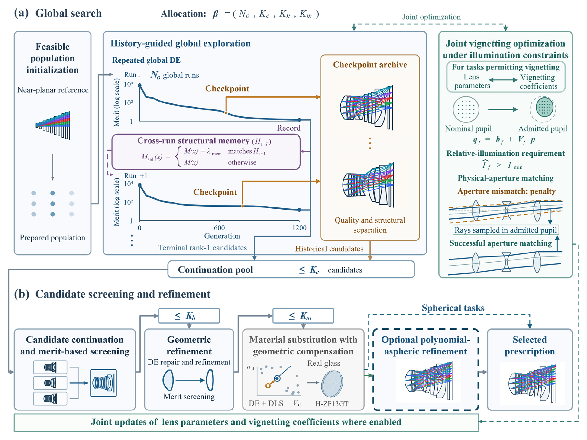
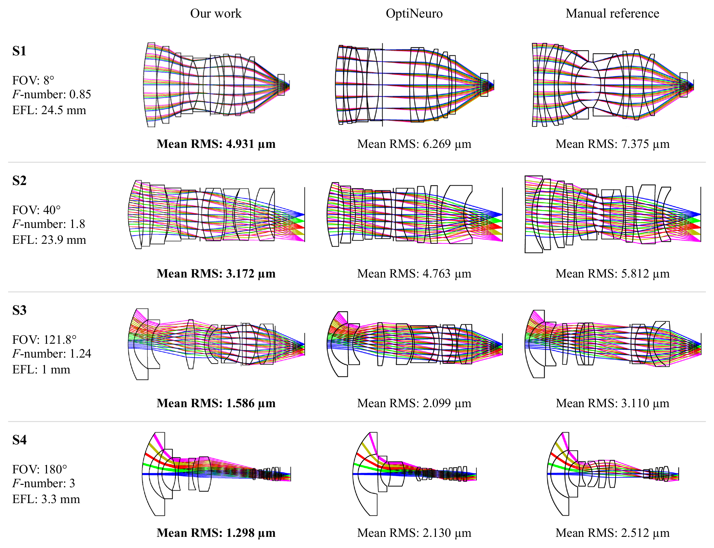
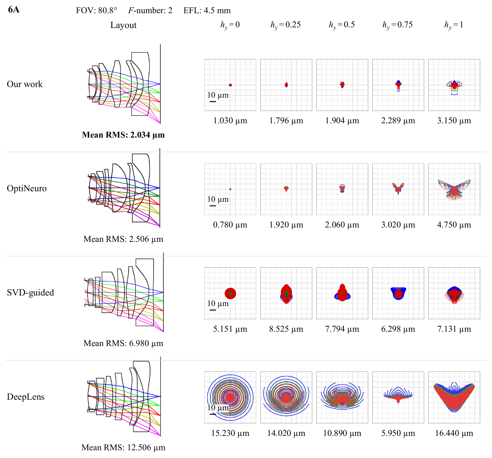
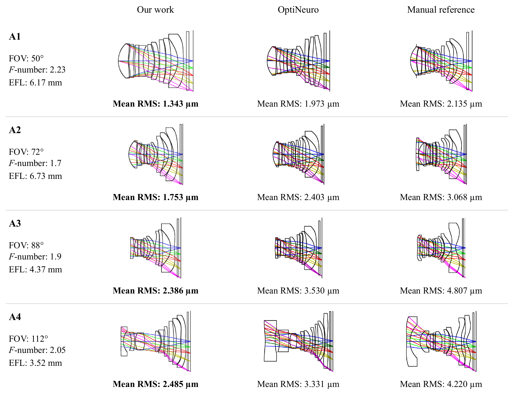
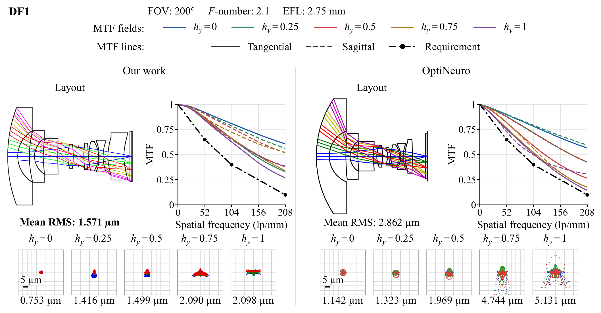

# Multi-stage automated lens design framework via history-guided differential evolution

This repository provides the optical design files accompanying the paper.

## Overview

This work presents a multi-stage hybrid optimization framework for automated lens design, with differential evolution (DE) as its core optimization algorithm. The framework incorporates a search-history-guided strategy that combines a trajectory-aware checkpoint archive with cross-run search memory to preserve promising intermediate solutions and discourage redundant exploration. For tasks permitting vignetting, the framework jointly optimizes lens parameters and field-dependent vignetting coefficients using relative-illumination estimation and aperture matching. It enables the automated design of high-quality coaxial refractive systems with spherical or aspheric surfaces, including challenging ultra-wide-angle and large-aperture lenses.

*Overview of the proposed multi-stage hybrid optimization framework.*

## Experimental Results

The framework is evaluated on ten benchmark tasks covering spherical glass lenses, plastic aspheric lenses, and a glass–plastic hybrid fisheye lens. The primary performance metric is the five-field mean geometric RMS spot radius.

### 1. Spherical Glass Tasks

Across all four spherical glass lens tasks (S1–S4), the proposed framework achieves lower five-field mean geometric RMS spot radii than both OptiNeuro and the corresponding manual reference designs. Relative to OptiNeuro, the reductions range from 21.3% to 39.1%, demonstrating the framework's ability to generate high-quality spherical lens designs across a wide range of apertures and fields of view.

*Comparison of spherical glass lens designs and their five-field mean geometric RMS spot radii.*

### 2. Plastic Aspheric Tasks

**Six-element benchmark (6A).** The six-element plastic aspheric lens task provides a common benchmark for comparing different automated design methods. Under comparable nominal specifications, our design achieves a five-field mean geometric RMS spot radius of 2.034 µm, compared with 2.506 µm for the best displayed OptiNeuro design, corresponding to an 18.8% reduction.

*Lens layouts and spot diagrams for the six-element benchmark.*

**Nine-element benchmarks (A1–A4).** Across the four nine-element plastic aspheric lens tasks, the proposed framework achieves five-field mean geometric RMS spot radii that are 25.4–32.4% lower than those of OptiNeuro. The resulting designs also outperform the corresponding manual references in this metric.

*Comparison of nine-element plastic aspheric lens designs and their five-field mean geometric RMS spot radii.*

### 3. Glass–Plastic Hybrid Fisheye Task

The hybrid fisheye task demonstrates the framework's ability to handle challenging ultra-wide-angle lens design. Under the same nominal specifications as the OptiNeuro benchmark, including a 200° field of view and an f-number of 2.1, our design achieves a five-field mean geometric RMS spot radius of 1.571 µm, compared with 2.862 µm for the OptiNeuro reference.

The figure below compares the lens layouts, spot diagrams, and MTF curves of the two designs.

*Comparison of the glass–plastic hybrid fisheye designs.*

## Code and Data Availability

The lens design files and material catalogs are available in the [data directory](data/).

The optimization source code will be released in this repository upon manuscript acceptance.
