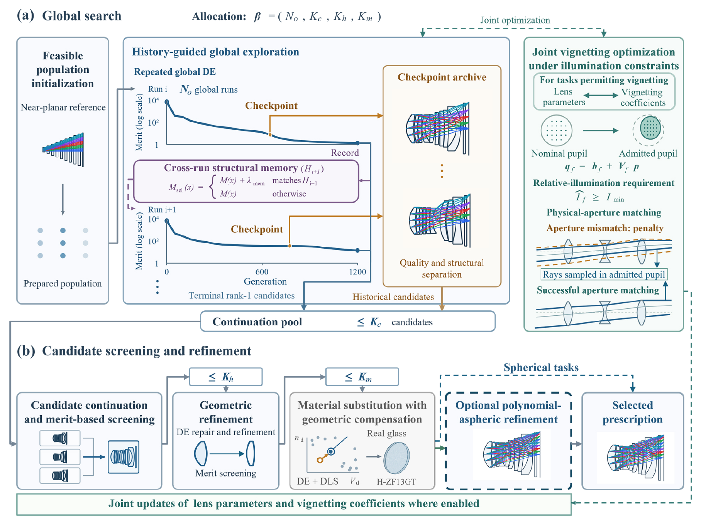

# Multi-stage automated lens design framework via history-guided differential evolution

## Overview

LensDE implements the multi-stage automated lens design framework described in the paper. This repository includes the source code, saved inputs, and published Zemax prescriptions for the ten benchmarks.

  

## Key features

- **History-guided optimization.** Combine JADE for global optimization with damped least squares (DLS) for local refinement. Checkpoints and search memory guide search restarts and which candidates advance through the stages, yielding initial structures with glasses selected from material catalogs. [Search and refinement stages](code/src/lensde/workflow/README.md)
- **Joint vignetting optimization.** For tasks that allow vignetting, use aperture-matching residuals and relative illumination constraints to optimize the vignetting coefficients jointly.
- **Accelerated ray tracing.** Use native C++ for CPU ray tracing and CUDA for GPU batch ray tracing and candidate evaluation. [C++ and CUDA backends](code/native/README.md)

## Intended uses

- **Initial design of coaxial refractive systems.** LensDE automatically generates initial lens prescriptions from optical design specifications and optimizes them for image quality. It supports large-aperture and ultra-wide-angle systems, as well as designs with even-order aspheric surfaces.
- **Optical datasets for AI training.** A potential use is generating and evaluating optical designs when building datasets for training AI models.

## Paper benchmarks

The benchmarks cover four spherical designs (S1–S4) and six designs with aspheric surfaces (6A, A1–A4, and DF1). Each benchmark has a saved starting system, design variables, merit settings, and run options. The published Zemax prescriptions and material catalogs are available under `data/`. [Benchmark inputs and commands](code/benchmarks/README.md) · [Published Zemax prescriptions](data/README.md)

## Run LensDE

For custom experiments that constrain back working distance (BFL), we recommend following the S1–S4 examples and adding an auxiliary surface behind the last powered lens element. We also recommend checking available disk space before starting an initial structure search. The search writes many intermediate files under `code/w/`, and some remain after it finishes.

Set up the Python environment, build the C++ and CUDA executables, and prepare the benchmark material database. [Source and setup](code/README.md) · [Material preparation](code/catalogs/README.md)

- **Command line.** Run a saved benchmark or pass a project JSON file to run your own workflow.
- **Browser Workbench.** Configure an optical system by hand and run ray-tracing or optimization experiments. The guide walks through loading S1, running the saved workflow, and inspecting the results. [Workbench guide](code/docs/workbench_en.txt)

## Acknowledgement

We thank the Optiland developers for their work. LensDE's native optical engine draws on Optiland's architecture and includes C++ adaptations of upstream implementations. Optiland copyright (c) 2024 Kramer Harrison. [Optiland project](https://github.com/optiland/optiland) · [Optiland MIT license](code/third_party/optiland_LICENSE.txt)

## License

The original LensDE source code is licensed under the [MIT License](LICENSE).
